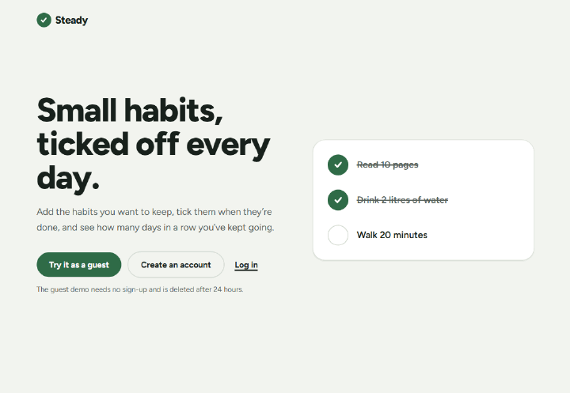
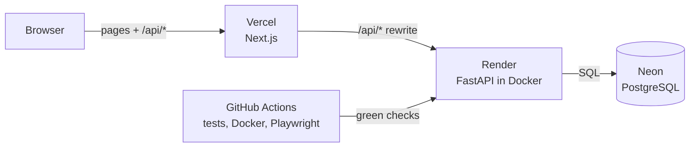

# habit-tracker

> **Steady**, a full-stack habit tracker: tick off your habits every day and watch your streaks grow. Next.js front end, FastAPI + PostgreSQL back end, Docker, and a CI/CD pipeline that only deploys tested code.

**Live:** https://habit-tracker-zeta-sooty.vercel.app (click **Try it as a guest**, no sign-up needed)



[](https://github.com/E54Sacha/habit-tracker/actions/workflows/ci.yml)


## Features

- **Try it in one click:** "Try it as a guest" opens your own demo account, filled with six weeks of example history and deleted after 24 hours.
- **Create an account:** sign up and log in with an email and a password (hashed with Argon2, session in an `httpOnly` cookie).
- **Track your habits:** add, rename and delete habits, and tick them for today; the tick shows instantly and rolls back if the server refuses it.
- **See your progress:** the streak of each habit ("23 days in a row") and a calendar of the last 8 weeks.
- **Use it anywhere:** works on a phone, follows your system's dark mode, and tells you when the free server is waking up.

## Architecture



The browser only ever talks to the Vercel site: Next.js forwards `/api/*` to the FastAPI server, so the login cookie is a first-party cookie (no CORS, never blocked as third-party). The API runs as a Docker image on Render and applies the Alembic migrations each time it starts. Render deploys a new version only after every GitHub Actions check of the commit has passed.

## Run it locally

**Requirements:** Docker Desktop, Python 3.12+, Node.js 20.9+.

```bash
git clone https://github.com/E54Sacha/habit-tracker.git
cd habit-tracker
docker compose up -d                 # PostgreSQL 17 (databases: habits, habits_test)

cd api
python -m venv .venv
.venv/Scripts/activate               # macOS / Linux: source .venv/bin/activate
pip install -r requirements-dev.txt
alembic upgrade head                 # create the tables
uvicorn app.main:app --port 8000     # http://localhost:8000/docs
```

In a second terminal:

```bash
cd habit-tracker/web
npm install
npm run dev                          # http://localhost:3000
```

The site forwards `/api/*` to `http://localhost:8000`. If that port is taken, run the API on another one and start the site with `API_URL=http://localhost:8001 npm run dev`.

**Tests:**

```bash
cd api && pytest --cov            # 34 tests against a real PostgreSQL, 100% coverage
cd web && npm run lint && npm run build
cd web && npm run e2e             # Playwright: sign up → create habit → tick → log out → log in (API must be running)
```

GitHub Actions runs all of them on every push, plus a check that the Docker image builds and starts with production settings.

## Project structure

```
api/
  app/main.py              FastAPI app and /health
  app/routers/auth.py      sign up, log in, log out, who am I, try as guest
  app/routers/habits.py    habits and today's ticks (owner-only)
  app/streaks.py           streak and 8-week history
  app/guest.py             demo accounts: example habits, cleanup after 24 h
  app/models.py            SQLAlchemy tables
  migrations/              Alembic migrations (the only way the schema changes)
  tests/                   pytest
  Dockerfile               the image Render runs
web/
  src/app/                 pages: home, login, signup, habits
  src/components/          HabitsBoard, HabitRow, Calendar, GuestButton…
  src/lib/api.ts           API calls, waking the free server, retries
  src/proxy.ts             sends logged-out visitors to /login
  e2e/                     Playwright tests
  next.config.ts           the /api/* rewrite to the API
.github/workflows/ci.yml   tests, Docker check, end-to-end test, coverage badge
render.yaml                Render service (deploys after green checks)
docker-compose.yml         local PostgreSQL
REQUIREMENTS.md            the scope and day-by-day plan
```

## What I learned

<!-- TODO: check these are true for you, and rewrite them in your own words -->
- **Authentication:** passwords are hashed with Argon2 (slow on purpose); the session is a signed JWT in an `httpOnly`, `Secure`, `SameSite=Lax` cookie; a wrong email and a wrong password get the same answer.
- **Migrations:** the schema only changes through versioned Alembic files, and a test fails if a model changes without a migration.
- **Containers:** the same PostgreSQL version runs on my PC, in CI and in production, and the API image is checked in CI before Render deploys it.
- **Dates are tricky:** "today" is the user's local day, so the browser sends it and the server accepts only a day within one day of UTC.

## What I'd do differently

- **Revocable sessions:** logging out only deletes the cookie, so a copied token works until it expires (7 days). A session table or short tokens with refresh tokens would fix it.
- **Sign-up reveals existing emails:** it answers "an account with this email already exists", unlike the login. An email confirmation flow would hide it.
- **Vercel deploys the front end even when CI is red** (only the API waits for green checks); a deploy step from GitHub Actions would make both wait.
- **No rate limit on log in yet:** add one before real users arrive.
